# Fraiseuse CNC 3 axes — conception et prototype en préparation

Ce dépôt documente la conception d’une fraiseuse CNC artisanale à trois axes et la préparation de son premier prototype.

## Dimensions prévues

- **Zone de travail visée :** 450 × 450 mm.
- **Dimensions maximales relevées sur le socle du modèle Fusion 360 :** 540 × 638 mm.

## Limites et évolutions envisagées

La conception prévoit deux axes ronds de **8 mm de diamètre** pour guider le portique mobile de l’axe Y. Cette faible section présente un risque de flexion sous le poids du portique.

Pour améliorer la rigidité, les pistes envisagées sont de passer à des axes de **12 mm de diamètre** ou mieux, d’utiliser des **rails de guidage linéaire avec chariots à billes** sur tout les axes. C'est la meilleure option.

Image : [IMTEK — comparaison des guides linéaires](https://imtekmotion.com/linear-guides-vs-linear-bushings-comparison/)

## État d’avancement

- **Conception CAO :** modèle de la machine réalisé dans Autodesk Fusion 360.
- **Pièces de fabrication :** les éléments du dossier **CNC_Fabrique** sont des composants enfants de la conception principale, prévus pour l’usinage. Ils ne constituent pas un projet séparé.
- **Matériel :** des composants majeurs ont été acquis. Une vidéo présente les matériels disponibles pour la mise au point du premier prototype ; leurs références et caractéristiques restent à détailler et vérifier.
- **Fabrication :** la machine complète n’a pas encore été construite. L’assemblage et la validation du prototype restent à réaliser.

## Visualiser l’assemblage dans Autodesk Fusion 360

[Ouvrir l’assemblage dans Autodesk Fusion 360](https://a360.co/4swDDnh)

## Vues de la conception Fusion 360

Les images ci-dessous montrent différentes vues du modèle CAO. Elles illustrent la conception et ne représentent pas une machine assemblée.

## Démarche

1. Concevoir la structure et les composants de la machine en CAO.
2. Préparer les pièces destinées à la fabrication et réunir les composants nécessaires.
3. Assembler le prototype.
4. Régler les axes et la commande, puis documenter les essais et les améliorations.

Les étapes d’assemblage et d’essais sont à venir ; ce dépôt ne prétend pas qu’elles ont déjà été effectuées.

## Expérience préalable avec GRBL : mini traceur artisanal

Avant cette machine, j’ai réalisé un petit traceur artisanal pour me familiariser avec les commandes GRBL. Il s’agit d’un montage distinct, qui m’a servi d’apprentissage et ne représente pas la fraiseuse 3 axes présentée ici.

## Matériels disponibles

Les photos et la vidéo ci-dessous montrent les composants disponibles pour préparer le premier prototype. Les dimensions exactes, références et caractéristiques électriques restent à relever avant la conception finale et le câblage.

Éléments identifiables sur les photos :

- vis trapézoïdales T8 et écrous/supports associés ;
- arbres de guidage de 8 mm et paliers linéaires SCS8UU ;
- moteurs pas à pas et accouplements ;
- supports de vis à roulement, avec des étiquettes visibles « KP08 horizontal » et « KP08 vertical » ;
- adaptateur portant l’indication ER11, dont la compatibilité reste à confirmer.

Les références exactes et les caractéristiques de ces pièces restent à vérifier. Les pilotes de moteurs pas à pas ne sont pas encore acquis ; la commande et les autres éléments électriques restent à définir.

<video src="Materiels%20disponibles.mp4" controls width="720"></video>

[Ouvrir ou télécharger la vidéo des matériels disponibles](Materiels%20disponibles.mp4)

### Photos des composants

  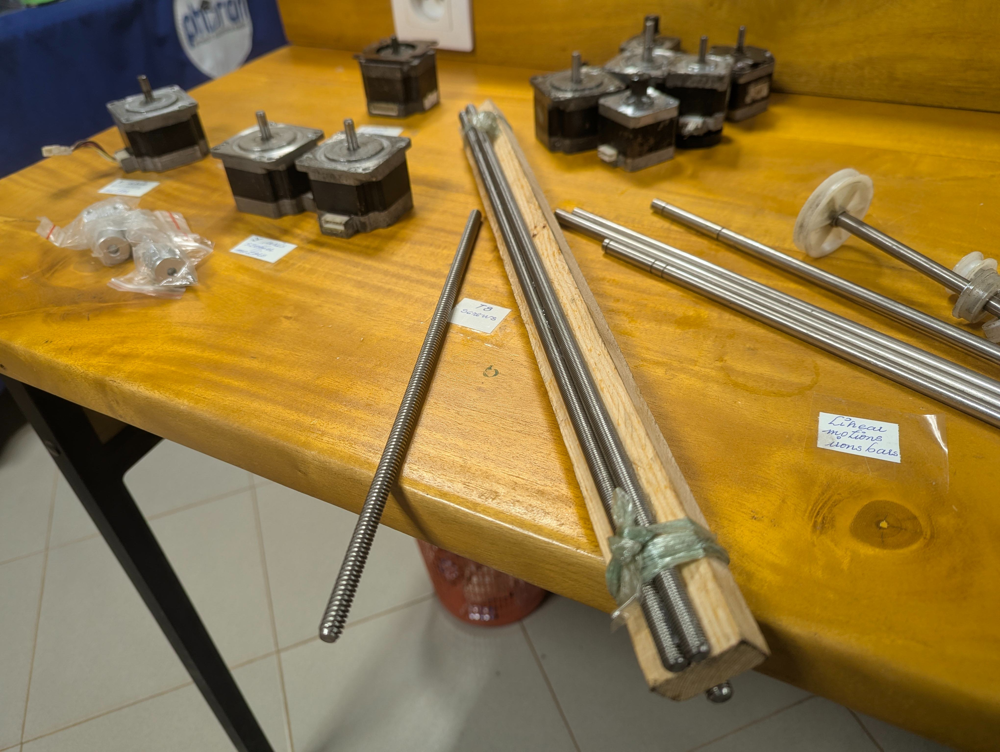
  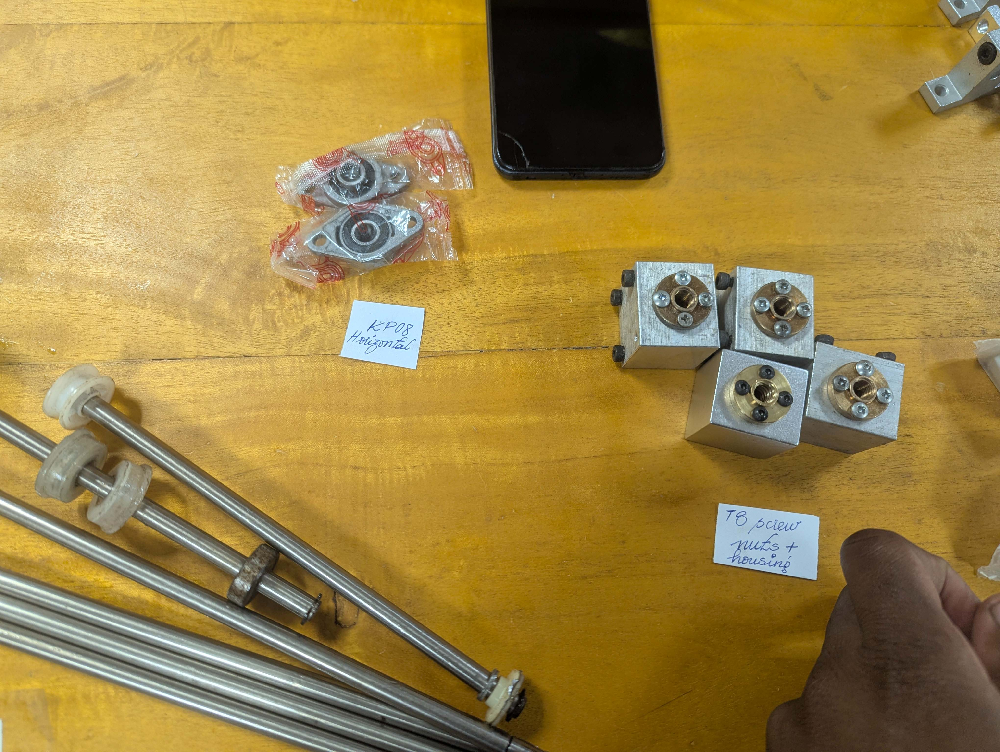
  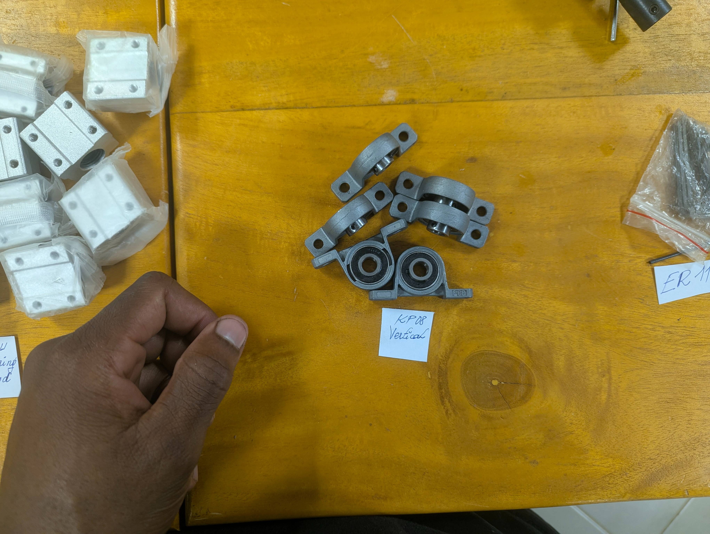

  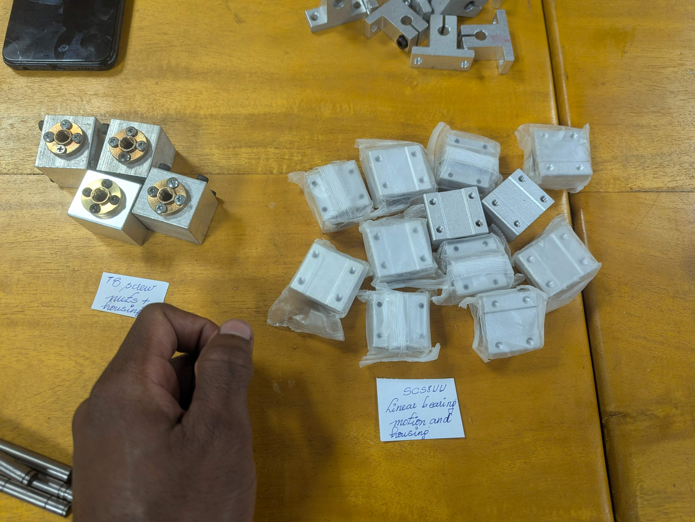
  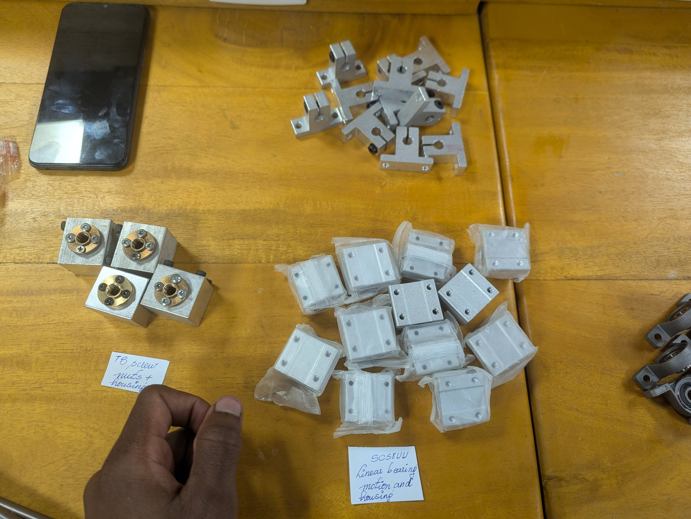
  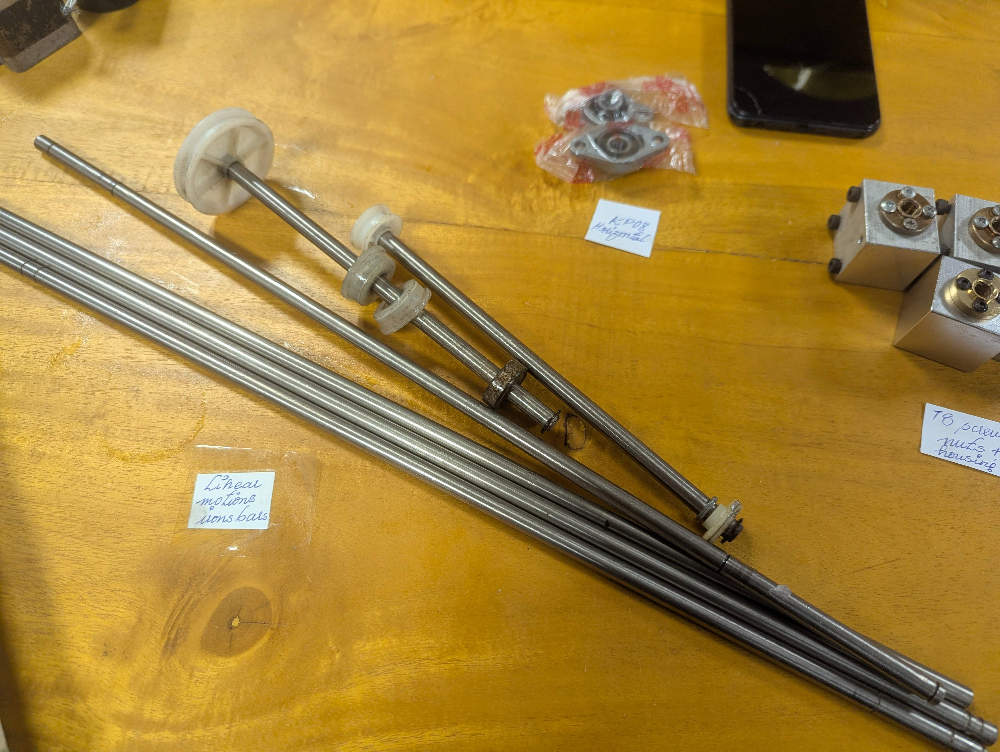

  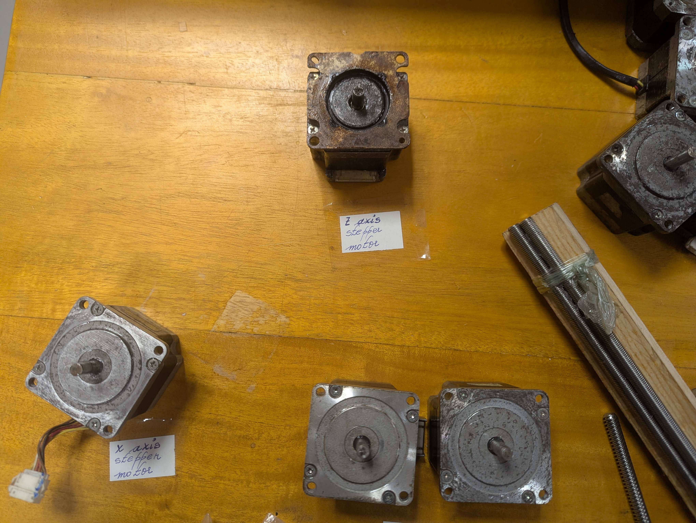
  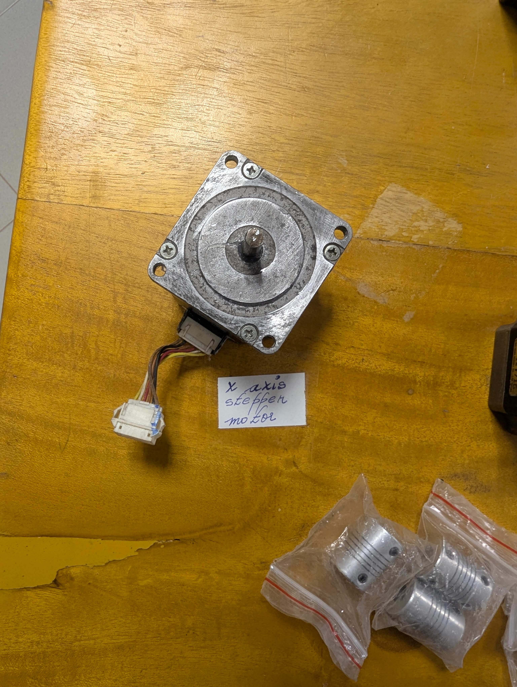
  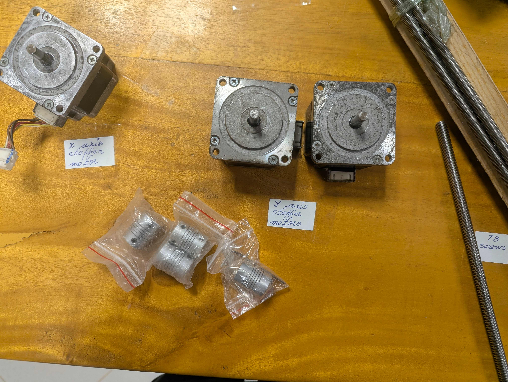

  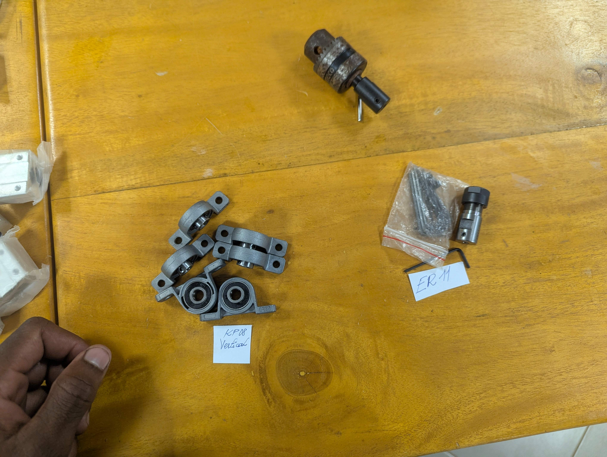
  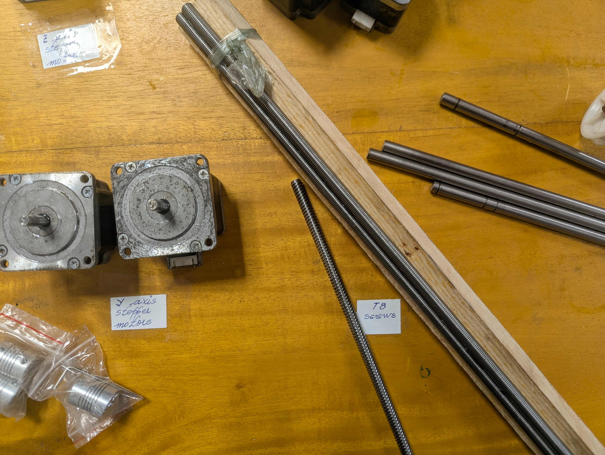

## Contenu du dépôt

- captures de la conception Fusion 360 ;
- images du mini traceur utilisé pour la prise en main de GRBL ;
- photos des matériels disponibles ;
- vidéo des matériels disponibles ;
- nomenclature des composants avec références et caractéristiques vérifiées (à compléter) ;
- photos de l’assemblage, résultats d’essais et améliorations du prototype à ajouter après réalisation.
